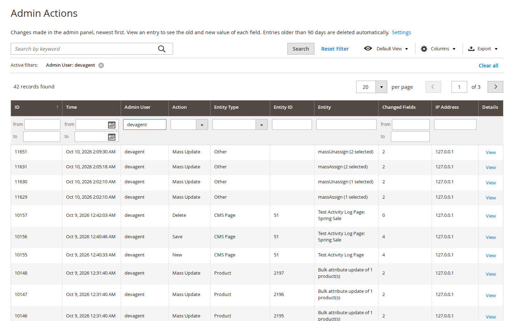
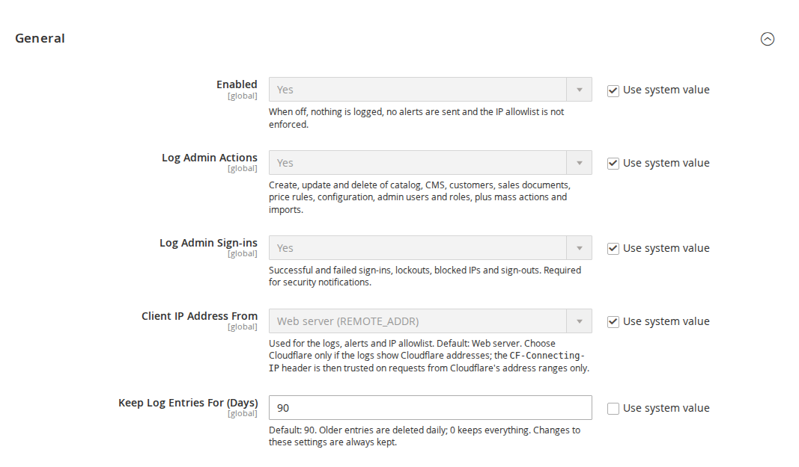
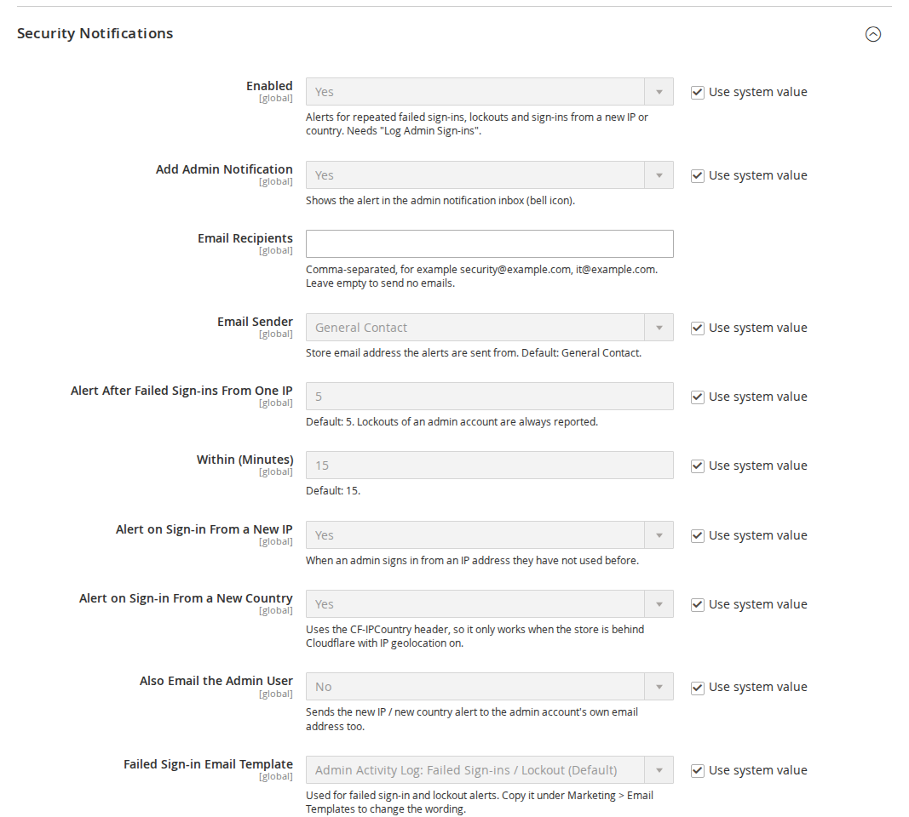
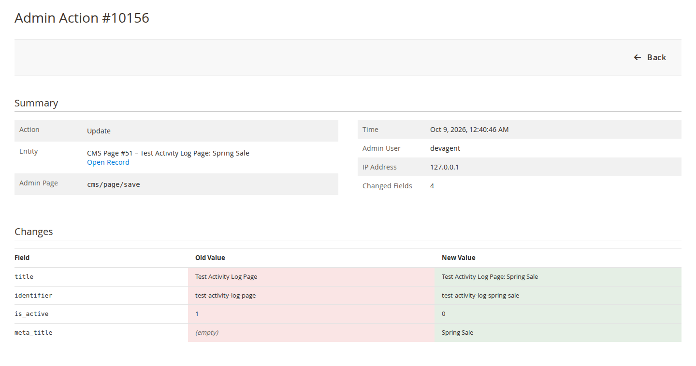
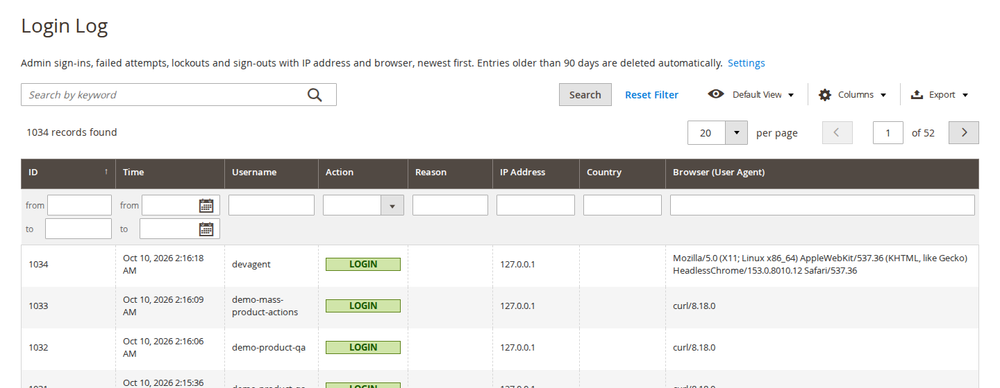
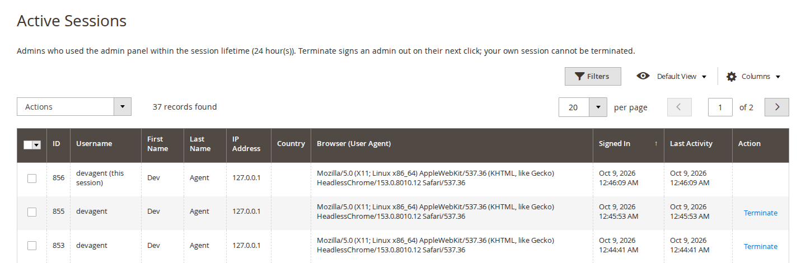

# Admin Activity Log for Magento 2: User Guide

See who changed what in the Magento admin, with the old and new value of every field, every admin sign-in and failed
attempt, and the admin sessions that are active right now. Get alerts for suspicious sign-ins and, if you want, limit
the admin to a list of IP addresses. This guide covers installation, configuration and day-to-day use.

- Admin demo: https://demo.commercegears.com/try-admin/admin-activity-log
- Changelog: [CHANGELOG.md](../CHANGELOG.md) · Questions: [FAQ](faq.md)



## 1. Requirements

| | |
| --- | --- |
| Magento | Open Source or Adobe Commerce 2.4.6 to 2.4.9 |
| PHP | 8.2 to 8.5 (Magento 2.4.6: PHP 8.2) |
| Storefront | None: the module is admin only |
| Other | `commercegears/module-core` (installed automatically) and Magento_Security (part of Magento) |

## 2. Installation

Install with Composer from repo.commercegears.com. The access keys are in your account on
commercegears.com; see [Composer access](https://commercegears.com/composer-access/) for details.

```bash
composer config repositories.commercegears composer https://repo.commercegears.com
composer config --auth http-basic.repo.commercegears.com PUBLIC_KEY PRIVATE_KEY
composer require commercegears/module-admin-activity-log
bin/magento setup:upgrade
bin/magento setup:di:compile            # production mode only
bin/magento setup:static-content:deploy # production mode only
bin/magento cache:flush
```

To update later: `composer update commercegears/module-admin-activity-log`, then the same `bin/magento` commands.

Logging starts straight after installation. The admin menu has **CommerceGears > Admin Activity Log** with **Admin
Actions**, **Login Log**, **Active Sessions** and **Settings**.

## 3. Settings

**Stores > Configuration > CommerceGears > Admin Activity Log** (also **CommerceGears > Admin Activity Log > Settings**). All
settings are global (default scope).



### General

| Setting | What it does |
| --- | --- |
| Enabled | Default Yes. When No, nothing is logged, no alerts are sent and the IP allowlist is not enforced. |
| Log Admin Actions | Default Yes. Create, update and delete of the records listed in section 4, plus mass actions and imports. |
| Log Admin Sign-ins | Default Yes. Successful and failed sign-ins, lockouts, blocked IPs and sign-outs. Required for security notifications. |
| Client IP Address From | **Web server** (`REMOTE_ADDR`, default) or **Cloudflare**. With Cloudflare, the `CF-Connecting-IP` and `CF-IPCountry` headers are trusted only on requests from Cloudflare's address ranges. Used for the logs, the alerts and the allowlist. |
| Keep Log Entries For (Days) | Default 90. Older entries are deleted daily; 0 keeps everything; at most 3650 (ten years). Changes to these settings are always kept. |

### Exclusions

| Setting | What it does |
| --- | --- |
| Do Not Log These Entities | Changes to the selected record types are not logged. Default: none. |
| Do Not Log These Configuration Paths | One path per line, `*` is a wildcard, for example `design/*`. Secret values are always masked, so they do not need to be listed. |

### Security Notifications



| Setting | What it does |
| --- | --- |
| Enabled | Default Yes. Alerts for repeated failed sign-ins, lockouts and sign-ins from a new IP or country. Needs "Log Admin Sign-ins". |
| Add Admin Notification | Default Yes. Shows the alert in the admin notification inbox (bell icon). |
| Email Recipients | Comma-separated addresses. Leave empty to send no emails (the admin notification still appears). |
| Email Sender | Store email identity the alerts are sent from. Default General Contact. |
| Alert After Failed Sign-ins From One IP | Default 5; 1 to 1000. Lockouts of an admin account are always reported. |
| Within (Minutes) | Default 15; 1 to 1440 (one day). |
| Alert on Sign-in From a New IP | Default Yes. When an admin signs in from an IP address they have not used before. |
| Alert on Sign-in From a New Country | Default Yes. Uses the `CF-IPCountry` header, so it only works behind Cloudflare with IP geolocation on. |
| Also Email the Admin User | Default No. Sends the new IP or new country alert to the admin account's own email address too. |
| Failed Sign-in Email Template | Default "Admin Activity Log: Failed Sign-ins / Lockout". |
| New IP / Country Email Template | Default "Admin Activity Log: Sign-in From New IP or Country". |

Copy a template under **Marketing > Email Templates** to change its wording, then select your copy here.

### Admin IP Allowlist

| Setting | What it does |
| --- | --- |
| Enabled | Default No. Only the listed IP addresses can sign in to and use the admin panel. |
| Allowed IP Addresses | One IP address or CIDR range per line, IPv4 or IPv6, for example `203.0.113.4` or `198.51.100.0/24`. Text after `#` is a comment. Your current IP address is shown below the field. An empty list allows every address. |

An enabled allowlist cannot be saved unless your current IP address is on it (checked with the "Client IP Address
From" value saved in the same form). An admin session used from
an IP address outside the list is treated as signed out, and the refused sign-in is recorded in the Login Log. If you
are locked out anyway (for example after your IP address changed), see section 9.

## 4. Admin Actions

**CommerceGears > Admin Activity Log > Admin Actions** lists every recorded change, newest first.

What is logged:

- **Catalog:** products, categories (including moves in the category tree), cart price rules, catalog price rules.
- **Content:** CMS pages and blocks.
- **Customers and sales:** customers, orders, invoices, shipments, credit memos, order and document comments.
- **System:** configuration (path, scope, old and new value), admin users, admin roles and role permissions.
- **Mass actions:** grid mass actions and the product "Update attributes" action, with the selection and the
  parameters. Records saved by the mass action are logged individually and linked by the request ID.
- **Imports** under System > Data Transfer > Import: entity, behaviour, processed rows and the created, updated and
  deleted counts.
- **Command line:** configuration changes made with `bin/magento config:set` (admin page "cli: config:set"), and
  changes made by commands or PHP scripts that run in the admin area (admin page "cli: <command>" or
  "cli: script <file name>"). These entries show "(command line)" as the admin user.

Changes that only swap one empty value for another (for example empty for "[]") are not listed, and neither are
values the system fills in by itself when a product is created (an empty image, "Display Product Options In" left at
its default).

Columns: ID, Time, Admin User, Action, Entity Type, Entity ID, Entity, Changed Fields, IP Address and Details. The
grid has keyword search (admin user, entity, entity ID, IP address, admin page, request ID), saved views, a column
chooser and **Export** to CSV or XML. The line above the grid says how long entries are kept, and a warning appears
when the action log is switched off.

The action names follow the Adobe Commerce action log (Save for created and changed records, Mass Update and Mass
Delete rather than one "Mass action"):

| Action | Meaning |
| --- | --- |
| Save | A record was created or changed, or a configuration value was changed (as in Adobe Commerce, both are Save; the detail page lists a new record's values under "Saved Values"). |
| Delete | A record was deleted. |
| Move | A category was moved in the category tree. |
| Mass Update | A grid mass action other than delete (for example change status), or the product "Update attributes" action. |
| Mass Delete | A grid mass delete. |
| Import | An import under System > Data Transfer > Import. |
| Cancel, Hold, Unhold | An order was cancelled, put on hold or released (single or from the orders grid). |

### Filters

The filter row sits directly under the column headings, as in Adobe Commerce: a from/to range for ID, Time and
Changed Fields, a list for Action and Entity Type, and a text field for the other columns. Type or choose values and
press **Enter** or click **Search**; **Reset Filter** clears all filters. The filters in use are listed above the grid
("Active filters"), where each one can be removed. Columns hidden with **Columns** have no filter field. When you
scroll down, the filter button in the sticky header takes you back to the filter row. Saved views (**Default View**)
remember the filters, and **Export** uses them.

### Entry details

Click **View** to open an entry. The summary shows the action, the entity with an **Open Record** link (or **Open
Configuration Section** for configuration), the admin page, time, admin user, IP address and number of changed fields.
Below it, **Changes** lists each field with its old and new value. New records, mass actions and imports show one
column of values ("Saved Values", "Mass Action Parameters", "Import Result"). Other changes made in the same request
are listed too.



### Masked values

Passwords, tokens, API, private and licence keys, passphrases, card fields, hashes, encrypted and obscured
configuration fields, configuration paths Magento declares sensitive and paths that look like keys or passwords are
stored as `******`. Nested mass-action parameters are masked the same way. Very large values are cut to 5,000
characters.

## 5. Login Log

**CommerceGears > Admin Activity Log > Login Log** lists sign-in events, newest first, with time, username, action,
reason, IP address, country and browser.



| Action | Meaning |
| --- | --- |
| Login | A successful sign-in. |
| Login Failed | A failed sign-in, with the reason: Unknown username, Wrong password, Account is inactive, or the account is locked. |
| Account Locked | Magento locked the admin account after too many failed attempts. |
| Login Blocked (IP) | The IP address is not on the admin allowlist. |
| Logout | The admin signed out. |

The country column is filled from Cloudflare's `CF-IPCountry` header when it is present. An unknown username that
could be a password typed into the wrong field (7 or more characters with letters and digits, not an email address)
is stored partly masked, for example `Se*** (masked, may be a password)`. The grid has keyword search, the same filter
row under the column headings as Admin Actions, and CSV or XML export.

## 6. Active Sessions

**CommerceGears > Admin Activity Log > Active Sessions** shows every admin who used the admin panel within the session
lifetime: username, name, IP address, country, browser, sign-in time and last activity. Your own session is marked
"(this session)".



Click **Terminate** on a row, or select several sessions and use the **Terminate** mass action. Each asks for
confirmation. The admin is signed out on their next click (Magento_Security behaviour). Your own session cannot be
terminated; use Sign Out instead.

## 7. Security notifications

When notifications are on, the module raises an alert for:

- the set number of failed sign-ins from one IP address within the set number of minutes;
- a lockout of an admin account (always);
- a sign-in from an IP address the admin has not used before;
- a sign-in from a country the admin has not signed in from before (Cloudflare only).

Alerts appear in the admin notification inbox (if "Add Admin Notification" is on) and are emailed to the recipients
you entered. New IP and new country alerts can also go to the admin user's own email address.

## 8. Retention and clean-up

The cron job `commercegears_activitylog_cleanup` runs daily at 03:17 and deletes entries older than "Keep Log Entries For
(Days)" in batches. Entries that record changes to the Activity Log's own settings are always kept, so switching
logging off or shortening the retention stays on record. Magento's cron must be running.

## 9. Command line

```bash
bin/magento commercegears:activity-log:clean [--days=N]
bin/magento commercegears:activity-log:allowlist
bin/magento commercegears:activity-log:allowlist --add=203.0.113.4
bin/magento commercegears:activity-log:allowlist --disable
```

- `clean`: deletes entries older than the retention period, or older than N days with `--days`.
- `allowlist`: shows whether the allowlist is on and the allowed addresses. `--add` adds an IP address or CIDR range.
  `--disable` switches the allowlist off: your way back in after a lock-out.

## 10. Permissions (ACL)

Under **System > Permissions > User Roles > Role Resources > CommerceGears > Admin Activity Log**:

| Resource | Allows |
| --- | --- |
| View Admin Actions | The Admin Actions grid and entry details |
| View Login Log | The Login Log grid |
| Manage Active Sessions | The Active Sessions grid and Terminate |
| Settings | The configuration section |

## 11. For developers

Other modules can have their own entities tracked by adding an item to the `types` argument of
`CommerceGears\ActivityLog\Model\EntityTypeResolver` in their `di.xml`, with the keys `class`, `label`, `label_fields`,
`extra_fields` and `ignore_fields`.

## 12. Troubleshooting

| Problem | Solution |
| --- | --- |
| Nothing is logged | Check **Enabled** and **Log Admin Actions** / **Log Admin Sign-ins**, and that the record type is not under **Do Not Log These Entities**. Changes made through the API, cron or direct SQL are not logged. |
| All IP addresses are the same (a proxy or Cloudflare address) | Configure the web server to pass the real client IP, or set **Client IP Address From** to Cloudflare if the store is behind Cloudflare. |
| The country column is empty, or there are no new country alerts | These need Cloudflare with IP geolocation, which sends the `CF-IPCountry` header. |
| No alert emails | Enter **Email Recipients** and check that the store can send email. Alerts still appear in the admin notification inbox. |
| Locked out by the allowlist | Run `bin/magento commercegears:activity-log:allowlist --disable` on the server, or add your new IP address with `--add`. |
| A terminated admin still sees the admin page | They are signed out on their next click. |
| Entries disappear after some time | That is the retention period (default 90 days). Set 0 to keep everything. |

## 13. Uninstall

```bash
bin/magento module:disable CommerceGears_ActivityLog
composer remove commercegears/module-admin-activity-log
bin/magento setup:upgrade
```

Switch the allowlist off before you remove the module. The log tables `commercegears_activity_log` and
`commercegears_activity_log_login` stay in the database; drop them yourself if you no longer need the history.
